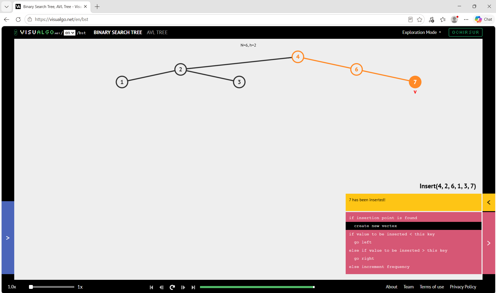

# Week 6: 이진 트리 순회 검증

## 1. VisuAlgo 구조 확인
VisuAlgo BST 모드에서 4, 2, 6, 1, 3, 7 순서로 삽입했다.
(A→4, B→2, C→6, D→1, E→3, F→7)
결과 트리는 예시 트리와 구조가 같다.
- 루트: 4 / 왼쪽 자식: 2 (자식 1, 3) / 오른쪽 자식: 6 (오른쪽 자식 7)
- 높이 2, 노드 6개, 리프 3개(1, 3, 7)

   

## 2. 방문 순서 수동 trace

### 전위 순회 (NLR): 4 2 1 3 6 7
1. 4 방문 → 왼쪽 2 이동
2. 2 방문 → 왼쪽 1 이동
3. 1 방문 (자식 없음, 복귀)
4. 2의 오른쪽 3 방문 (복귀)
5. 4의 오른쪽 6 방문 → 6의 왼쪽은 없음
6. 6의 오른쪽 7 방문

### 중위 순회 (LNR): 1 2 3 4 6 7
1. 4 → 2 → 1까지 왼쪽으로 내려간다.
2. 1 방문 → 복귀하여 2 방문 → 오른쪽 3 방문
3. 복귀하여 4 방문
4. 오른쪽 6으로 이동. 왼쪽이 없으므로 6 방문 → 7 방문

### 후위 순회 (LRN): 1 3 2 7 6 4
1. 1 방문 → 3 방문 → 두 자식이 끝났으므로 2 방문
2. 6의 왼쪽은 없으므로 7 방문 → 6 방문
3. 마지막으로 4 방문

### 레벨 순회 (BFS): 4 2 6 1 3 7
큐 변화:
1. [4] → 4 방문, 2와 6 enqueue → [2, 6]
2. 2 방문, 1과 3 enqueue → [6, 1, 3]
3. 6 방문, 7 enqueue → [1, 3, 7]
4. 1, 3, 7 순서로 방문 후 종료

## 3. 코드 결과와 비교
| 순회 | 수동 trace | 코드 출력 | 일치 |
|---|---|---|---|
| preorder | 4 2 1 3 6 7 | [4, 2, 1, 3, 6, 7] | O |
| inorder | 1 2 3 4 6 7 | [1, 2, 3, 4, 6, 7] | O |
| postorder | 1 3 2 7 6 4 | [1, 3, 2, 7, 6, 4] | O |
| levelorder | 4 2 6 1 3 7 | [4, 2, 6, 1, 3, 7] | O |

## 4. 테스트 케이스
빈 트리(높이 -1), 단일 노드, 편향 트리(1→2→3), 완전 트리(1~7)를 테스트했고 모두 통과했다.

## 5. 시간·공간 복잡도
n = 노드 수, h = 높이(간선 기준), w = 최대 레벨 너비

| 연산 | 시간 | 보조 공간 |
|---|---|---|
| 재귀 DFS 3종 / 반복 전위 | O(n) | O(h+1) |
| 큐 기반 레벨 순회 | O(n) | O(w) |
| 높이 / 노드 수 / 리프 수 | O(n) | O(h+1) |
| 완전 트리 구성 | O(n) | O(n) |

- 모든 순회는 각 노드를 정확히 한 번 방문하므로 시간은 O(n)이다.
- DFS는 재귀 호출 스택(또는 명시적 스택)이 높이만큼 쌓이므로 공간이 O(h)이다.
  균형 트리는 h = O(log n), 편향 트리는 h = O(n)이다.
- BFS는 큐에 한 레벨의 노드가 동시에 들어가므로 O(w)이다.
- 편향 트리가 매우 깊으면 Python 재귀 깊이 제한에 걸릴 수 있다.
